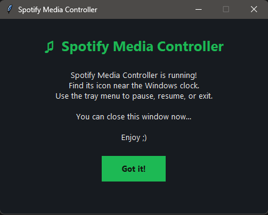
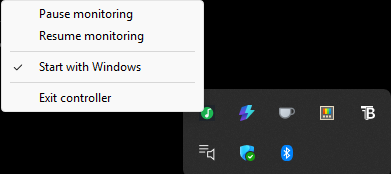
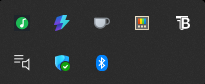

# Spotify Media Controller

A small Python project that keeps Spotify from playing over other media on Windows.

Ever started playing a video in your browser only to have Spotify continue playing in the background? This app is designed to handle that automatically. It pauses Spotify when another media source starts playing and resumes it once that media stops.

## What It Can Do

- **Auto-pause Spotify:** Pauses Spotify when other media starts playing.
- **Auto-resume:** Resumes Spotify when the competing media stops, if the controller was responsible for pausing it.
- **Works with different apps:** Detects media playback from browsers and supported desktop applications.
- **System tray controls:** Pause monitoring, turn it back on, or exit the app from the system tray.
- **Welcome window:** Shows a simple welcome screen when the app starts.
- **Runs in the background:** No need to keep a terminal window open while using it.


## Screenshots

### Welcome Screen


### Application Icon


### System Tray


## Technologies Used

- Python
- Windows Media Control API
- Pycaw
- Pystray
- Pillow
- Tkinter

## How It Works

The app monitors Windows media sessions and audio sessions to check whether other media is playing.

When it detects competing playback, it tries to pause Spotify. Once that playback stops, it resumes Spotify if it was the one that paused it in the first place.

The idea is simple: let Spotify play when nothing else is playing, without having to pause and resume it manually every time.

## Requirements

- Windows 10 or Windows 11
- Python 3.14 or a compatible Python version
- Spotify desktop app
- The required Python packages listed below

## Getting Started

### 1. Install Python

Download and install Python if you don't already have it.

### 2. Get the project

Clone this repository or download the source code and extract it into a folder.

### 3. Install the dependencies

Open a terminal in the project folder and run:

```bash
pip install -r requirements.txt
```

### 4. Run the app

Start the controller using:

```bash
python controller.py
```

## How to Use It

1. Launch the application.
2. Click **Got it!** on the welcome window.
3. Look for the app icon near the Windows clock.
4. Right-click the icon to pause monitoring, resume monitoring, or close the app.

Once it's running, the controller handles media detection in the background.

## Current Status

This project is still a work in progress. I'm building it as a personal Python project, so some features and compatibility may change as development continues.

## About

Built as a personal project to make listening to Spotify alongside other media on Windows a little less annoying.
